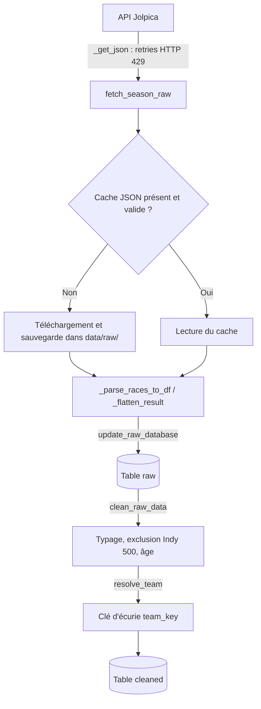

# Dashboard F1 (1950-2025) - Pipeline de données et visualisation

Projet réalisé dans le cadre de l'unité "Python 2" de la première année de la filière Data Science et Intelligence Artificielle à ESIEE Paris.

Ce projet propose une infrastructure d'analyse historique de la Formule 1 de 1950 à 2025, à partir de données publiques ouvertes.


## User Guide

### Prérequis

- Python 3.11 ou plus récent
- Le gestionnaire d'environnements [`uv`](https://github.com/astral-sh/uv).

### Installation et lancement

1. Cloner le dépôt public :
```bash
git clone https://git.esiee.fr/sarkara/data_project_f1.git
cd data_project_f1
```

2. Installer l'environnement et les dépendances exactes :
```bash
uv sync
```

3. Lancer le dashboard :
```bash
uv run python main.py
```

Le dashboard est ensuite accessible dans un navigateur à l'adresse `http://127.0.0.1:8050`.

La base `data/db.sqlite` est fournie dans le dépôt : **le dashboard démarre sans connexion internet**, aucun téléchargement n'est effectué au premier lancement.

### Reconstruction des données (optionnel)

Pour régénérer la base à partir de l'API (connexion internet requise) :
```bash
uv run python -m src.utils.get_data         # téléchargement -> data/raw/ + table 'raw'
uv run python -m src.utils.clean_data       # nettoyage -> table 'cleaned'
```

Le script de téléchargement respecte les limites de l'API (pause entre les requêtes et nouvelle tentetive en cas de refus HTTP 429).

### Démonstration vidéo

*(À venir - la vidéo de démonstration sera ajoutée à la fin du développement)*.


## Data

### Source

- **API** : Jolpica F1, miroir compatible de l'API Ergast : `https://api.jolpi.ca/ergast/f1/`
- **Point d'accès utilisé** : `/{année}/results.json` paginé (100 résultats maximum par page)
- **Accès** : données publiques, ouvertes et réutilisables librement

### Contenu

Chaque observation correspond au **résultat d'un pilote lors d'un Grand Prix** : saison, manche, date, circuit (avec coordonnées GPS), pilote, écurie, position de départ et d'arrivée, statut (arrivée, abandon...) et points marqués.

### Conformité aux exigences

- **Volume d'observations** : *25 468* lignes dans la table `cleaned` (`SELECT COUNT(*) FROM cleaned`), sur plus de 1 100 Grands Prix.
- **Variable numérique continue** : `age_at_race`, l'âge du pilote le jour de la course (en années, à deux décimales).
- **Géolocalisation** : coordonnées GPS (`lat`, `long`) de chaque circuit.

### Nettoyage (table `cleaned`)

- Conversion des colonnes numériques (l'API renvoie uniquement des chaînes).
- Exclusion des 500 Miles d'Indianapolis de 1950 à 1960 : la course comptait pour le championnat du monde mais était disputée avec des voitures et des pilotes IndyCar.
- Calcul de l'âge des pilotes. Une date de naissance manquante donne un âge vide au lieu d'une erreur.
- Attribution d'une clé d'écurie unique `team_key`, qui suit la filiation historique des équipes (voir le Developer Guide).

### Stockage et rafraîchissement
| Niveau | Emplacement | Rôle | Suivi par git |
|---|---|---|---|
| Cache brut | `data/raw/results_AAAA.json` | Réponses de l'API, une par saison | Non (régénérable) |
| Table `raw` | `data/db.sqlite` | Données brutes aplaties, sans modification | Oui |
| Table `cleaned` | `data/db.sqlite` | Données typées et enrichies, lues par le dashboard | Oui |

**Mécanisme de rafraîchissement** : les saisons terminées sont figées. Seul le cache de la saison la plus récente (`END_YEAR`) expire, au bout de `CACHE_MAX_AGE_DAYS` jours (7 par défaut) : il est alors télécarhgé à nouveau. Ces paramètres se règlent dans `config.py`.


## Developer Guide

### Arborescence

```text
data_project_f1/
├── data/
|   ├── db.sqlite                   # base SQLite (tables 'raw' et 'cleaned')
|   └── raw/                        # cache local JSON par saison (ignoré par git)
├── src/
|   ├── __init__.py
|   ├── components/                 # composants du dashboard
|   |   ├── __init__.py
|   |   └── layout.py
|   └── utils/
|       ├── __init__.py
|       ├── clean_data.py           # table 'raw' -> table 'cleaned'
|       ├── common_functions.py     # fonctions partagées (table_exists)
|       └── get_data.py             # API -> cache JSON -> table 'raw'    
├── tests/
|   ├── __init__.py
|   ├── conftest.py                 # fixtures partagées (base temporaire)
|   ├── test_clean_data.py                # Précision de la version de Python utilisée
|   ├── test_common_functions.py
|   └── test_get_data.py
├── .gitignore
├── .python-version
├── config.py                       # Configuration centralisée
├── main.py                         # Point d'entrée
├── pyproject.toml                  # Dépendances et configuration des outils
├── README.md
└── uv.lock
```

### Pipeline de données



### Résolution de la filiation des écuries

Une même écurie apparaît sous plusieurs identifiants au fil de son histoire (par exemple Minardi → Toro Rosso → AlphaTauri → RB), alors que certains identifiants désignent des équipes sans aucun lien selon l'époque (Alfa Romeo usine en 1950 et Alfa Romeo-Sauber en 2020). La fonction `resolve_team(constructor_id, season)` de `clean_data.py` applique trois règles dans l'ordre :

1. `LINEAGE_BY_YEAR` : identifiants homonymes, départagés par la saison.
2. `TEAM_LINEAGE` : renommages et rachats.
3. une expression régulière pour les identifiants châssis-moteur des années 1950-1960 (`lotus-climax` → `team_lotus`).

Les écuries qui n'ont qu'un seul identifiant le conservent tel quel.

### Gestion des limites de l'API (erreurs 429 et pagination)

L'API Jolpica limite les requêtes à 4 par seconde et 500 par heure, et renvoie au maximum 100 résultats par requête. Comme une course compte une vingtaine de résultats (un par pilote), une saison doit être téléchargée en plusieurs pages, et l'historique complet (1950-2025) représente environ 300 requêtes. Au-delà des limites, l'API répond `429 Too Many Requests`. La fonctions `_get_json` et `fetch_season_raw(yer)` de `get_data.py` gère ces contraintes de quatre façons :

1. Une pause de `PAUSE = 0.35` secondes entre deux requêtes, pour rester dans la limite de 4 requêtes par seconde.
2. En cas d'erreur 429, une attente progressive de 15 secondes multipliées par le numéro de la tentative, plafonnée à `MAX_BACKOFF = 60` secondes, avec au plus `MAX_ATTEMPTS = 8` tentatives. 
3. Une pagination par `offset` : on avance de 100 résultats à chaque requête jusqu'à atteindre le total annoncé par l'API. Une course coupée entre deux pages est reconstituée en fusionnant ses résultats grâce à son numéro de manche (`round`).
4. Un cache JSON par saison (`data/raw/results_{year}.json`) : une saison déjà téléchargée n'est jamais redemandée, donc un téléchargement interrompu reprend là où il s'était arrêté.

Tous ces paramètres sont modifiables dans `config.py`.

### Tests

Les tests utilisent `pytest`, installé automatiquement par `uv sync`. Pour les lancer :

```bash
uv run pytest -v
```

| Fichier | Ce qui est vérifié |
|---|---|
| `test_clean_data.py` | Résolution des écuries (renommages, homonymes, châssis-moteur, identifiants inconnus ou absents) et construction complète de la table `cleaned` |
| `test_common_functions.py` | Détection des tables dans la base SQLite |
| `test_get_data.py` | Aplatissement du JSON, conversion en DataFrame, expiration du cache, lecture du cache sans réseau, nouvelle tentative après un HTTP 429 |

Principes :
- **Aucun appel réseau** : les réponses de l'API sont simulées avec `monkeypatch`
- **Aucune modification de la vraie base** : la fixture `tmp_db` (`conftest.py`) redirige `config.DB_PATH` vers une base temporaire, propre à chaque test.

### Qualité du code

Les outils d'analyse statique sont configurés dans `pyproject.toml` :

```bash
uv run ruff check .                     # bonnes pratiques et tri des imports
uv run pylint src tests config.py       # qualité du code
uv run mypy src tests config.py         # typage (mode strict)
uv run radon cc src config.py -s -a     # complexité cyclomatique
uv run radon mi src config.py -s        # indice de maintenabilité
```

### Ajouter une page ou un graphique

*À COMPLÉTER avec la partie dashboard.*


## Rapport d'analyse

*À COMPLÉTER : principales conclusions tirées des données.*


## Copyright

Nous déclarons sur l'honneur que le code fourni a été produit par les membres du groupe, à l'exception des éléments listés ci-dessous. Toute ligne non déclarée ci-dessous est réputée avoir été produite par les auteurs du projet.

### Code produit avec l'aide de l'intelligence artificielle

| Emplacement | Contenu | Explication de la syntaxe |
|---|---|---|
| `clean_data.py` : `TEAM_LINEAGE`, `LINEAGE_BY_YEAR`, `_CHASSIS_TO_TEAM`, `resolve_team` | Tables de filiation, complétées et corrigées | `re.compile(r"^([a-z_]+)-[a-z_]+$")` reconnaît un identifiant de la forme `châssis-moteur`, `match.group(1)` renvoie la partie capturée entre parenthèses, c'est-à-dire le châssis |
| `tests/conftest.py` | Fixture `tmp_db` | `monkeypatch.setattr` remplace temporairement un attribut, restauré à la fin du test |
| `tests/test_get_data.py` | Simulation de l'API | `SimpleNamespace(status_code=..., json=lambda: ...)` crée un faux objet réponse, `os.utime` modifie la date d'un fichier pour simuler un cache ancien | 

### Prompts structurants

1. *Filiation des écuries* : « J'essaie de faire un projet avec l'API Ergast/Jolpica de F1, entre 1950 et 2025. Sauf que j'ai du mal à établir la lignée des équipes, (exemple bête : AlphaTauri -> VCARB mais sans spécifier que c'est la même équipe le modèle pensera que ce sont deux équipes différentes alors que non), du coup je voulais savoir si tu pouvais m'aider à faire la lignée pour chaque équipe entre 1950 et 2025. Tu peux regarder sur internet évidemment, que ce soit pour les lignées et aussi pour les constructorId qu'utilise Ergast/Jolpica. Voici ce que j'ai pour le moment. » (suivi de notre premier dictionnaire `TEAM_LINEAGE`).
2. *Simulation des données pour les tests unitaires* : « Je suis en train de rédiger les tests unitaires de mes fonctions pour le pipeline de données. Je sais qu'il ne faut pas utiliser la base de données déjà présente et en recréer une nouvelle "exprès" pour les tests, qui sera supprimée ensuite. De plus vu qu'on crééra un fichier exprès pour tester la fonction d'expiration de cache, existe-t-il un moyen de modifier la date d'un fichier pour le faire apparaître plus vieux qu'il ne l'est ? Enfin, je ne pense pas que ce soit une bonne idée de faire de réels appels à l'API en ligne, puisque le projet est de base censé fonctionner sans réseau. Tu pourrais m'aider à mettre en place une "simulation" des appels et réponse de l'API qui tournerait localement afin de tester ma logique face aux erreurs HTTP 429 ? »

### Bibliothèques et données

- Bibliothèques tierces : `dash`, `pandas`, `plotly`, `requests` (listées dans `pyproject.toml`).
- Données : [API Jolpica F1](https://api.jolpi.ca/ergast/).
