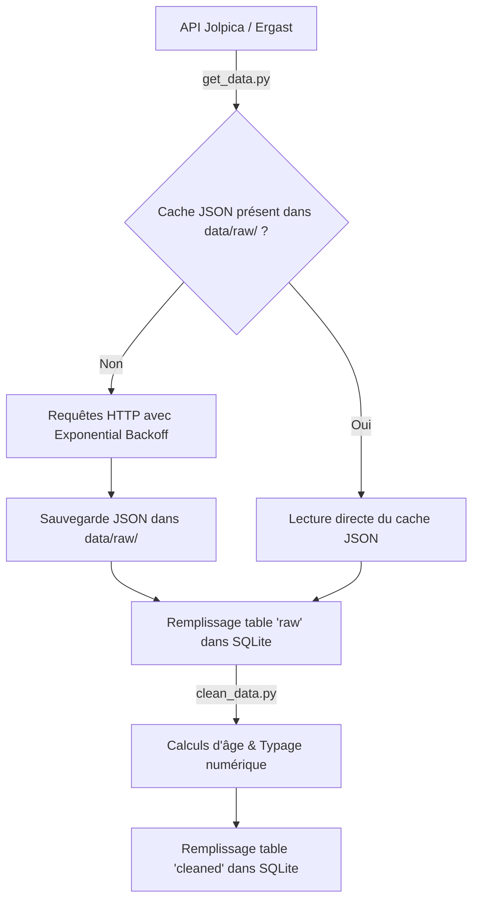

# Dashboard F1 (1950-2025) - Pipeline de données et visualistion

Projet réalisé dans le cadre de l'unité "Python 2" de la première année du cursus Data Science et Intelligence Artificielle à ESIEE Paris.

Ce projet propose une infrastructure d'analyse historique de la Formule 1 de 1950 à 2025, à partir de données publiques ouvertes.


## User Guide

### Déploiement et exécution

L'application utilise le gestionnaire d'environnement virtuel [`uv`](https://github.com/astral-sh/uv).


1. Cloner le dépôt public
```bash
git clone https://git.esiee.fr/sarkara/data_project_f1.git
cd data_project_f1
```

2. Synchroniser l'environnement et installer les dépendances exactes
```bash
uv sync
```

3. Lancer le dashboard
```bash
uv run python main.py
```

### Démonstration vidéo

*(À venir - la vidéo de démonstration sera ajoutée à la fin du développement)*.


## Data

### Source des données

Les données proviennent de l'API publique Open Data **Jolpica F1** (miroir du projet Ergast) :

* **URL de l'API** : `https://api.jolpi.ca/ergast/f1/`
* **Accès** : données publiques, ouvertes et réutilisables librement.


### Conformité aux exigeances

* **Volume d'observation (`OBS`)** : 25 873 lignes de résultats individuels sur plus de 1 100 Grands Prix (`OBS` > 25 000).

* **Variable numérique non catégorielle** : `age_at_race` (âge continu du pilote le jour d'une course), `position`, `points`. 

* **Géolocalisation** : Coordonnées GPS (`lat`, `long`) enregistrées pour chaque circuit.


### Stratégie de stockage (cache local)

Pour respecter la contrainte de **fonctionnement hors-ligne**, le projet s'appuie sur une base SQLite (`data/db.sqlite`) et un cache local JSON :

1. **Cache brut (`data/raw/`)** : chaque saison est sauvegardée localement (`results_{year}.json`) lors du premier téléchargement. Si ces fichiers existent, aucun appel réseau n'est effectué.

2. **Table `raw`** : stocke l'intégralité du jeu de données brutes extrait du cache.

3. **Table `cleaned`** : contient les données transformées, typées avec calculs d'âge et alignement historique des écuries.


## Developer Guide

### Structure actuelle du projet

```text
data_project_f1/
├── data/
|   ├── db.sqlite           # Base SQLite (tables 'raw' et 'cleaned')
|   └── raw/                # Cache local JSON par saison (results_YYYY.json)
├── src/
|   ├── components/
|   |   ├── __init__.py
|   |   └── layout.py
|   └── utils/
|       ├── __init__.py
|       ├── get_data.py     # Ingestion API, cache local JSON et remplissage de 'raw'
|       └── clean_data.py   # Nettoyage, typage et résolution d'écuries ('cleaned')
├── .gitignore
├── .python-version         # Précision de la version de Python utilisée
├── config.py               # Configuration centralisée (chemins, constantes API)
├── main.py                 # Point d'entrée principal
├── pyproject.toml          # Dépendances du projet (gérées par uv)
├── README.md               # Documentation
├── uv.lock                 # Verrouillage des versions exactes
```

### Pipeline d'ingestion et de nettoyage (Mermaid)



### Défis techniques résolus

1. **Gestion des erreurs HTTP 429 (rate limiting)** :
L'extraction de 75 saisons implique de nombreuses requêtes. Une fonction d'accès réseau avec temporisation progressive (exponential backoff) a été implémentée dans `get_data.py`pour retenter automatiquement en cas de réponse 429 du serveur.


## Copyright

Je déclare sur l'honneur que le code fourni a été produit par les membres du groupe, à l'exception des éléments documentés ci-dessous :

* **Bibliothèques tierces** : `pandas`, `requests`, `sqlite3` repertoriés dans `pyproject.toml`.
* **API Open Data** : données fournies par le projet [Jolpica F1 / Ergast API](https://api.jolpi.ca/ergast/f1/).


### Assistance par intelligence artificielle

Conformément aux consignes du sujet, l'IA a été sollicitée pour aider à structurer l'algorithme de résolution de filiation des écuries.

**Prompts structurants :**

* *"Comment résoudre la lignées des écuries de F1 entre 1950 et 2025 en tenant compte des homonymes d'époque différentes (ex : Alfa Romeo usine vs Sauber) et des IDs châssis-moteur (ex : lotus-climax) ?"*
